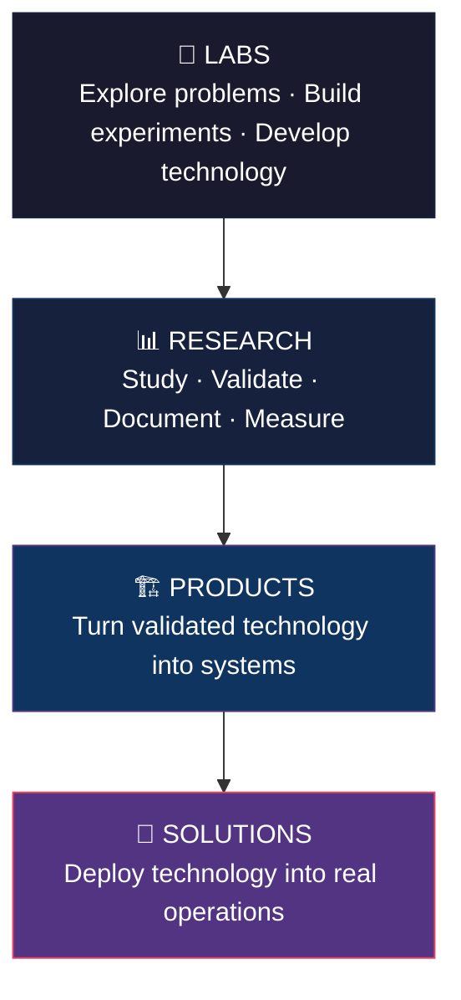
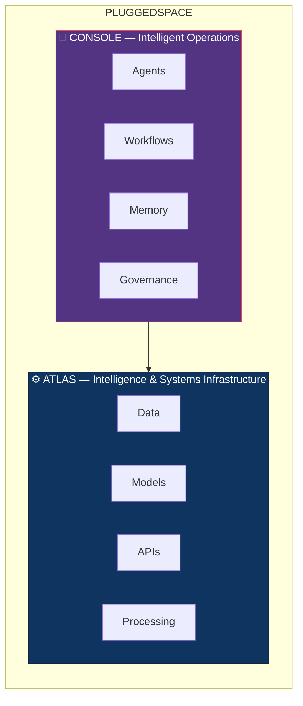

<h2 align="center">Pluggedspace</h2>

**We research, build, and deploy technology for complex systems.**

Pluggedspace is a technology company building software, infrastructure, intelligent systems, and emerging technologies for organizations operating in complex environments.

---

**About**

We combine research, engineering, and deployment to turn difficult technical problems into systems that can be operated in the real world.

Our work spans **intelligent software**, **data**, **automation**, **infrastructure**, **security**, and **emerging technologies**.

---

**How We Build**

Pluggedspace operates through a continuous technology lifecycle:

**🧪 Labs — *Where technology starts***

Pluggedspace Labs explores new architectures, systems, technologies, and ideas through experiments, prototypes, and applied engineering.

Projects may become products, infrastructure, research, open-source software — or may simply inform what we build next.

**[→ Explore Labs](https://pluggedspace.org/labs)**

**📊 Research — *Where we turn experiments into knowledge***

Research documents technical findings, architectural approaches, field tests, experiments, and lessons learned from building and operating real systems.

**[→ Explore Research](https://pluggedspace.org/research)**

**🏗️ Products — *Where validated technology becomes usable***

Our products package technologies developed through research and engineering into platforms and systems that organizations can actually operate.

**[→ Explore Products](https://pluggedspace.org/products)**

**🚀 Solutions — *Where technology meets the real world***

Pluggedspace applies its platforms, infrastructure, and engineering capabilities to complex organizational problems that require implementation, integration, or custom systems.

**[→ Explore Pluggedspace](https://pluggedspace.org)**

---

**Products**

Pluggedspace currently develops platforms across intelligent systems, data, automation, and infrastructure.

**Atlas — *Intelligence and systems infrastructure***

[**Atlas**](https://atlas.pluggedspace.org) is Pluggedspace's intelligence and systems engine for building applications and infrastructure around data, models, APIs, automation, and decision processes.

Atlas provides foundations for:

- Data and intelligence workloads
- AI and model-driven systems
- Data processing and orchestration
- Analytical and decision-support systems
- APIs and system integration
- Intelligent applications
- Automated system execution

**[→ Explore Atlas](https://atlas.pluggedspace.org)**

**Pluggedspace Console — *The operating environment for intelligent work***

[**Pluggedspace Console**](https://agents.pluggedspace.org) is Pluggedspace's managed environment for deploying and operating AI agents across organizational workflows.

Console brings together:

| Capability | Capability | Capability |
|---|---|---|
| Agents | Tools & Integrations | Human Approvals |
| Orchestration | Policies | Workflow Automation |
| Memory | Governance | Autonomous Operations |

It supports **manual**, **hybrid**, and **autonomous** operating modes.

**[→ Explore Pluggedspace Console](https://agents.pluggedspace.org)**

---

**The Stack**

Atlas and Console operate at different layers of the Pluggedspace technology stack.

- **Atlas** provides the systems and intelligence foundation.
- **Console** provides the operational layer for intelligent work.

Together they form part of the current Pluggedspace platform architecture.

---

**Open Source**

We open-source selected technologies developed through our engineering and research work.

Our public repositories include infrastructure, security, compliance, developer tools, experiments, and other technologies that we believe can create value beyond Pluggedspace.

| Project | Description | Frameworks / Capabilities | Link |
|---|---|---|---|
| **Trust Portal** | Open-source compliance and trust infrastructure for organizations managing security, governance, risks, evidence, audits, policies, and compliance workflows | ISO 27001 · ISO 9001 · SOC 2 · GDPR · NDPR | [github.com/pluggedspace/trustportal](https://github.com/pluggedspace/trustportal) |
| **Ethical** | Open-source security assessment and automation toolkit | Network recon · Vulnerability assessment · Password auditing · Log analysis · Security automation · Self-hosted workflows | [github.com/pluggedspace/ethical](https://github.com/pluggedspace/ethical) |

**[→ Explore All Repositories](https://github.com/pluggedspace?tab=repositories)**

---

**Technology**

Our engineering work is built around open technologies and composable systems.

Our current stack includes:

> The specific technology stack evolves with the problem. Our engineering principles remain consistent.

**Engineering principles:**

- Composable systems
- Interoperable infrastructure
- Automation by default
- Operational reliability
- Evidence-driven development

---

**What We Explore**

Our work is not restricted to a single technology category. Current and emerging areas include:

<table>
<tr>
<td width="33%">

- Artificial intelligence
- Agentic systems
- Data infrastructure
- Intelligent automation
- Distributed systems

</td>
<td width="33%">

- Software infrastructure
- Security and governance
- Decision systems
- Human-AI collaboration
- Developer infrastructure

</td>
<td width="33%">

- Applied machine learning
- Emerging computing technologies
- Hardware and connected systems

</td>
</tr>
</table>

> The technologies we work on will change. **The problems we choose to solve are the constant.**

---

**Work With Pluggedspace**

There are several ways to engage with the Pluggedspace ecosystem.

| Path | Purpose |
|:--|:--|
| 🏗️ **Products** | Use Pluggedspace platforms and technology. |
| 🚀 **Solutions** | Deploy and integrate technology into real organizational environments. |
| 🔓 **Open Source** | Use, study, extend, and contribute to our public projects. |
| 📊 **Research** | Explore technical research, field tests, and engineering findings. |
| 🧪 **Labs** | Explore experiments and emerging technologies. |

---

**Our Approach**

We believe useful technology sits at the intersection of research, engineering, and operations.

We do not build technology simply because it is possible.

Then we decide what deserves to become **infrastructure**, a **product**, an **open-source project**, or something else entirely.

---

<h2 align="center">Pluggedspace</h2>

**Research. Build. Deploy.**
*Technology for complex systems.*

[Website](https://pluggedspace.org) · [Labs](https://pluggedspace.org/labs) · [Research](https://pluggedspace.org/research) · [Products](https://pluggedspace.org/products) · [GitHub](https://github.com/pluggedspace)

